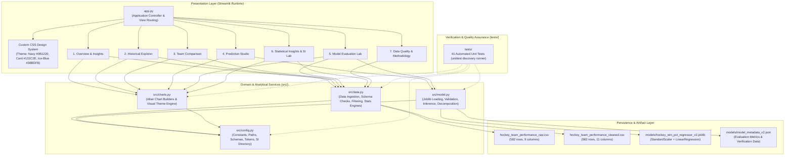
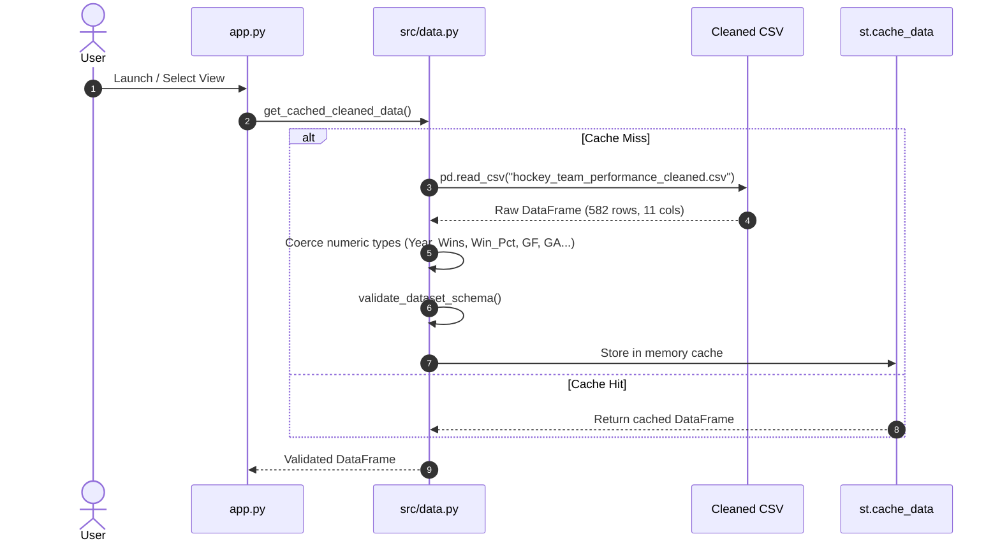
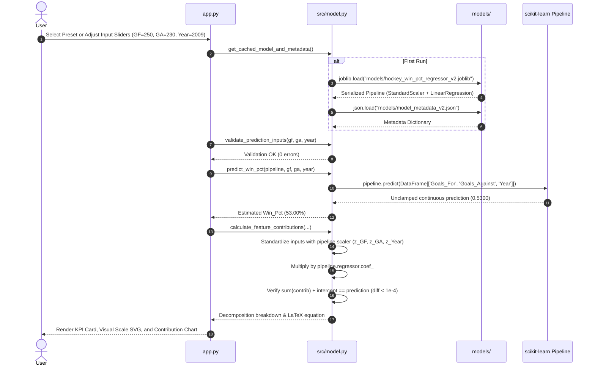

# Hockey Performance Intelligence System Architecture & Technical Specifications

> **Project:** Hockey Performance Intelligence  
> **Course / Context:** B.Tech System Integration (SI) Lab & Technical Portfolio  
> **File:** `ARCHITECTURE.md`  
> **Status:** Verified Implementation (Phase 2D Complete · 41 Automated Tests)

---

## 1. High-Level Architecture

Hockey Performance Intelligence is built upon a modular, layered Python architecture that decouples user interface rendering, business analytics, inferential statistics, machine learning inference, and data persistence.



---

## 2. Presentation Layer (`app.py`)

`app.py` serves as the primary controller and routing coordinator for the Streamlit application. It manages session state, injects styling, and directs control flow to the selected analytical view.

### Key Responsibilities
1. **Design System & CSS Injection (`inject_custom_css`):**
   - Injects bespoke CSS styling enforcing the high-contrast dark sports-analytics theme.
   - Enforces design tokens: background `#0B1220`, card surfaces `#131C2E`, border `#1E293B`, and primary accent `#38BDF8`.
   - Normalizes metric card typography, tables, and expandable containers.
2. **Sidebar Navigation Controller:**
   - Presents a clean radio-button controller organizing the application into 7 distinct views.
   - Displays real-time dataset badges and architectural metadata.
3. **View Renderers:**
   - `render_overview_view(df)`: High-level KPI summary, empirical key findings, and global distributions.
   - `render_historical_explorer_view(df)`: Multi-criteria historical query engine, interactive table, timeline chart, CSV export, and statistical leaderboards.
   - `render_team_comparison_view(df)`: Head-to-head franchise comparative analysis with grouped bar charts and historical mutual overlap matrix.
   - `render_prediction_studio_view(pipeline, metadata)`: Interactive performance estimation studio with preset scenarios, continuous sliders, SVG scale, and standardized explainability waterfall.
   - `render_model_evaluation_view(pipeline, metadata, df)`: 5-candidate model comparison, CV vs. Test RMSE charts, Actual vs. Predicted scatter, residual diagnostics, and naive baseline analysis.
   - `render_statistical_insights_view(df)`: Interactive SI Lab curriculum, real-time Central Limit Theorem simulation, One-sample $t$-test, ANOVA, and Chi-Square contingency heatmap.
   - `render_methodology_view(df, metadata)`: Data provenance transparency, missing value audit, target leakage prevention, cross-validation rationale, and model parameter decomposition.

---

## 3. Modular Domain Services (`src/`)

The application logic is partitioned into four single-responsibility Python modules:

### A. Configuration & Constants (`src/config.py`)
- **Single Source of Truth:** Centralizes file paths, feature lists, target definitions, historical benchmarks, and theme tokens.
- **Path Resolution:** Anchors all paths dynamically to the project root directory (`BASE_DIR`) rather than relying on the process current working directory.
- **Model Benchmark Constants:** Maintains empirical verification baselines:
  - 582 historical records across 1990–2011 (excluding the 2004 lockout year).
  - Historical win percentage bounds: min 11.90% (1992 Ottawa Senators), mean 45.85%, max 75.60% (1995 Detroit Red Wings).
  - Historical average goals for and against: 234.06.
- **Preset Scenarios Dictionary:** Defines canonical test scenarios (*Test Sample 2009*, *Top Contender 2010*, *League Average 2006*, *Rebuilding Team 2003*).
- **Candidate Models Evaluation Matrix:** Stores the authoritative cross-validation and test metrics for all five evaluated regression pipelines.
- **SI Lab Practicals Directory:** Indexes all 16 academic practicals with topic titles, tools, and experimental aims.

### B. Data Access & Analytics Engine (`src/data.py`)
- **Data Caching & Loading:**
  - `load_cleaned_data(filepath)` / `load_raw_data(filepath)`: Loads raw/cleaned CSV datasets and enforces numeric type coercion on numeric columns.
  - `get_cached_cleaned_data(filepath)`: Streamlit-cached wrapper (`@st.cache_data`) for zero-latency page rerenders. Employs `_is_streamlit_running()` guard to allow seamless execution in unit test environments without Streamlit dependencies.
- **Schema & Quality Diagnostics:**
  - `validate_dataset_schema(df)`: Validates row counts (exactly 582), required columns, absence of nulls in core features, and presence of exactly 224 unrecorded pre-1999 `OT_Losses`.
- **Query & Analytics Services:**
  - `filter_historical_records(df, ...)`: Multi-criteria filtering by season range, team list, and win-percentage tier.
  - `get_leaderboards(df, ...)`: Computes top-$N$ and bottom-$N$ leaderboards across Win %, Goal Diff, Goals For, and Goals Against with tie-breaking.
  - `compare_teams(df, team_a, team_b, season)`: Extracts head-to-head franchise metrics, calculates deltas, and isolates common competitive seasons.
- **Statistical Inference Engines:**
  - `run_clt_simulation(df, sample_size, iterations, random_seed)`: Executes repeated random sampling without replacement from historical win percentages, proving Central Limit Theorem convergence.
  - `get_statistical_insights_data(df)`: Dynamically computes One-sample $t$-test against $\mu = 0.500$, 95% Confidence Interval, One-way ANOVA across decades with Tukey HSD post-hoc contrasts, Pearson and Spearman correlation matrices, and Chi-Square contingency tables.
  - `get_model_evaluation_data(pipeline, df)`: Computes held-out test predictions (seasons 2008–2011, 120 team-seasons), test MAE/RMSE/$R^2$, season-by-season breakdowns, residual distributions, naive training-mean baseline comparisons, and Durbin-Watson autocorrelation ($DW \approx 1.079$).

### C. Model Inference & Explainability (`src/model.py`)
- **Safe Pipeline Loading:**
  - `load_model_and_metadata(model_path, metadata_path)`: Deserializes the active scikit-learn pipeline (`models/hockey_win_pct_regressor_v2.joblib`) and parses metadata JSON. Falls back gracefully to `v1` artifacts if `v2` is absent.
  - `get_cached_model_and_metadata(...)`: Cached wrapper (`@st.cache_resource`) preventing redundant disk I/O on every UI interaction.
- **Strict Input Validation:**
  - `validate_prediction_inputs(gf, ga, year)`: Validates numerical types, finiteness, positive bounds ($GF > 0, GA > 0$), hockey plausibility ($GF, GA \le 1000$), and calendar ranges ($1890 \le Year \le 2050$).
- **Deterministic Inference:**
  - `predict_win_pct(pipeline, gf, ga, year)`: Enforces strict input feature ordering (`['Goals_For', 'Goals_Against', 'Year']`), evaluates continuous Ordinary Least Squares regression, and returns unclamped decimal estimates.
- **Exact Standardized Feature Decomposition:**
  - `validate_contribution_breakdown(pipeline, metadata)`: Inspects fitted pipeline step names (`scaler`, `model`) and confirms parameter availability (`mean_`, `scale_`, `coef_`, `intercept_`).
  - `calculate_feature_contributions(...)`: Decomposes predictions into exact standardized $z$-scores and linear contributions:
    $$z_j = \frac{x_j - \mu_j}{\sigma_j}, \quad \text{contrib}_j = \beta_j \cdot z_j, \quad \hat{y} = \beta_0 + \sum_{j=1}^3 \text{contrib}_j$$
    Mathematically verifies that $\hat{y}$ matches `pipeline.predict()` within $10^{-4}$ numerical tolerance.

### D. Declarative Visualization Engine (`src/charts.py`)
- **Unified Theme Configuration:**
  - `apply_theme_config(chart)`: Applies the dark theme specification (transparent chart background, `#1E293B` gridlines, `#94A3B8` tick labels, and `#F1F5F9` titles).
- **Chart Builders:**
  - `build_win_pct_distribution_chart(df)`: Histogram with overlaid Kernel Density Estimation (KDE) and historical mean annotation.
  - `build_goal_diff_scatter_chart(df, ...)`: Goal differential vs. win percentage scatter with discrete performance-tier coloring and OLS trendline.
  - `build_team_timeline_chart(df, ...)`: Multi-season win percentage trajectory with highlighted team lines.
  - `build_h2h_grouped_bar_chart(...)`: Head-to-head grouped bar chart across four core metrics.
  - `build_cv_rmse_comparison_chart(...)` & `build_test_rmse_comparison_chart(...)`: Comparative model performance bar charts with selected model highlighting.
  - `build_actual_vs_predicted_chart(test_df)`: Held-out test set scatter plot with red diagonal identity line.
  - `build_residual_distribution_chart(test_df)`: Residual histogram with zero-mean reference rule.
  - `build_error_by_season_chart(season_df)`: MAE and RMSE tracking across test seasons 2008–2011.
  - `build_clt_simulation_chart(...)`: Monte Carlo sampling distribution histogram with theoretical normal curve overlay.
  - `build_anova_decade_boxplot(df)`: Distribution of winning percentages binned by decade.
  - `build_chisquare_heatmap(contingency_df)`: Interactive 2D contingency heatmap visualizing franchise tier distributions across historical eras.

---

## 4. End-to-End Data & Inference Pipelines

### Data Loading & Schema Verification Flow



### Model Loading & Prediction Flow



---

## 5. Machine Learning Validation Architecture

Sports time-series data violates the Independent and Identically Distributed ($i.i.d.$) assumption of standard random $K$-fold cross-validation. Hockey Performance Intelligence employs a strictly chronological partitioning and validation strategy:

```mermaid
gantt
    title Chronological Dataset Partitioning & Expanding-Window Cross-Validation
    dateFormat  YYYY
    axisFormat  %Y

    section Full Dataset (582 rows)
    Training Period (462 rows)       :done,    des1, 1990, 2008
    Held-Out Test Set (120 rows)     :crit,    des2, 2008, 2012

    section Expanding-Window CV
    Fold 1: Train 1990-1996 -> Val 1997-1998 :active, f1, 1990, 1999
    Fold 2: Train 1990-1998 -> Val 1999-2000 :active, f2, 1990, 2001
    Fold 3: Train 1990-2000 -> Val 2001-2002 :active, f3, 1990, 2003
    Fold 4: Train 1990-2002 -> Val 2003,2005 :active, f4, 1990, 2006
    Fold 5: Train 1990-2005 -> Val 2006-2007 :active, f5, 1990, 2008
```

### Architectural Principles of Validation
1. **Disjoint Validation Sets:** In every fold, validation years are strictly later than all training years. Information never leaks from future seasons into the past.
2. **Scaler Hygiene:** Inside each fold, `StandardScaler` is fitted strictly on the training subset and applied without refitting to the validation subset.
3. **Purity of Test Set:** The 2008–2011 holdout set (120 records) was never used for model selection, feature selection, or hyperparameter tuning.

---

## 6. Testing & Quality Assurance Architecture

The test suite resides in `tests/` and executes under Python's native `unittest` discovery framework:

```text
tests/
├── test_analytics.py   (9 tests)  -> Historical filtering, leaderboards, team comparisons, CSV serialization
├── test_data.py        (10 tests) -> Schema integrity, row counts, null verification, lockout year, bounds
├── test_evaluation.py  (7 tests)  -> 5 candidate models, test metrics, baseline comparisons, residual DW
├── test_model.py       (8 tests)  -> Joblib loading, pipeline architecture, feature order, math identity
└── test_stats.py       (7 tests)  -> One-sample t-test, ANOVA, Chi-Square, CLT simulation, 16 practicals
```

### Test Execution Command
```bash
./venv/bin/python -m unittest discover tests -v
```

### Test Guarantees
- **Total Test Count:** 41 automated tests.
- **Execution Time:** ~0.60 seconds.
- **Pass Rate:** 100% (41 passing, 0 failures, 0 errors).
- **Headless GUI Integration:** Streamlit AppTest framework validates that all 7 navigation views render with zero exceptions.

---

## 7. Dependency & File Relationship Map

| Source File | Imported By | Consumed Data / Artifacts |
| :--- | :--- | :--- |
| `src/config.py` | `src/data.py`, `src/model.py`, `src/charts.py`, `app.py`, all `tests/` | None (pure configuration) |
| `src/data.py` | `app.py`, `tests/test_data.py`, `tests/test_analytics.py`, `tests/test_evaluation.py`, `tests/test_stats.py` | `hockey_team_performance_cleaned.csv`, `hockey_team_performance_raw.csv` |
| `src/model.py` | `app.py`, `tests/test_model.py`, `tests/test_evaluation.py` | `models/hockey_win_pct_regressor_v2.joblib`, `models/model_metadata_v2.json` |
| `src/charts.py` | `app.py`, `tests/test_evaluation.py`, `tests/test_stats.py` | Receives DataFrames from `src/data.py` and `app.py` |
| `app.py` | Main execution entrypoint | Consumes all `src/` modules, datasets, and models |
| `tests/` | `unittest` discovery runner | Tests all `src/` modules and model artifacts |

---

## 8. Architectural Invariants

To guarantee long-term reproducibility and scientific integrity, the following invariants are strictly preserved:

1. **Dataset Immutability:** Neither `hockey_team_performance_raw.csv` nor `hockey_team_performance_cleaned.csv` are modified at runtime.
2. **Model Persistence:** The production artifact `models/hockey_win_pct_regressor_v2.joblib` is loaded read-only; no online retraining or parameter mutation occurs during application execution.
3. **Feature Ordering Invariant:** Input vectors passed to `pipeline.predict()` must strictly maintain the schema `['Goals_For', 'Goals_Against', 'Year']`. Any transposition or omission raises an immediate validation exception.
4. **Leakage Exclusion Invariant:** `Wins`, `Losses`, `OT_Losses`, and `Goal_Diff` are strictly barred from entering the model feature matrix.
5. **Clean Fallbacks:** If `v2` model artifacts are missing, the system gracefully degrades to `v1` artifacts without crashing, while logging explicit operational warnings.
